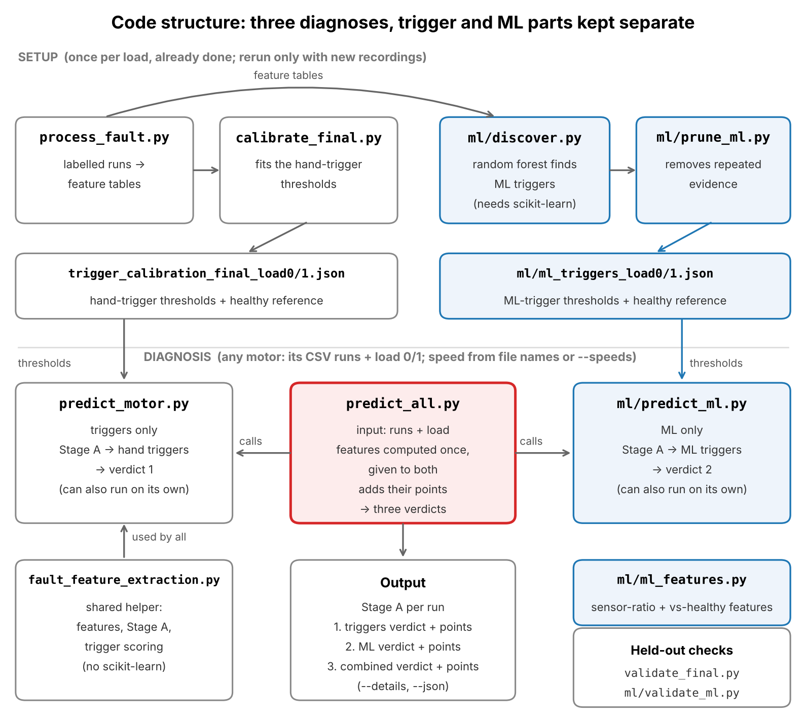

# Motor fault diagnosis (v5): hand-found triggers + ML-found triggers

Diagnoses an induction motor from its 8 speed runs (accelerometers 1-3, microphone, temperature),
given whether the motor is loaded. Possible verdicts: healthy, bowed rotor, faulty bearing,
broken rotor bars, rotor misalignment, rotor unbalance, stator winding. Voltage unbalance can't be
told apart with these sensors.

It gives **three diagnoses** side by side:
1. **triggers**: the hand-found triggers only
2. **ML**: the triggers found by the machine-learning search only
3. **combined**: the points of 1 and 2 added together

The two parts are kept separate. Each has its own trigger list, calibration file and predictor.

## Quick start
    pip install numpy scipy pandas pywavelets          # enough to diagnose
    python3 predict_all.py path/to/motor_folder --load 1
    python3 predict_all.py a.csv b.csv ... --load 0 --speeds speeds.csv --details --json result.json

Each part also runs on its own:

    python3 predict_motor.py path/to/motor_folder --load 1      # triggers only
    python3 ml/predict_ml.py path/to/motor_folder --load 1      # ML only

scikit-learn is only needed to rerun the ML search itself (`ml/discover.py`).

## Input
- One CSV per run (420,000 rows = 10 s at 41,666.7 Hz) with Accelerometer 1/2/3, Microphone,
  Temperature columns. The time column is optional; without it fs = 41,666.7 Hz is assumed.
- `--load 0|1` (required): unloaded or loaded. This selects the calibration files and trigger sets.
- The speed profile of each run (condition 1-8) is read from file names like `X_X_<cond>_<load>.csv`,
  or from `--speeds`, a CSV with the columns `file,condition_id`.
  1: 15 Hz, 2: 30, 3: 45, 4: 60 (constant); 5: 15->45, 6: 30->60, 7: 45->15, 8: 60->30.
- Optional `--healthy <folder>`: healthy runs from your own rig at the same load, used as the
  reference instead of the built-in one. Recommended on a different rig.

## Output (predict_all.py)
- **Stage A per run:** how many times the healthy vibration (accelerometer 1) and sound level it
  shows. A run is faulty if either is at least 2x healthy.
- **Three verdicts** with their points and confidence. If no run is faulty, all three are
  "healthy" and no fault type is classified.
- Confidence: "clear" if the winner has at least 3 points and at least 2x the runner-up, else "weak".
- A note says whether the triggers and the ML agree. A disagreement means the motor deserves a
  closer look.
- `--details` lists which triggers fired in every run. `--json` saves everything.
- Fewer than 8 runs gives a warning, because single runs are unreliable.

## How the files call each other

| File | Role |
|---|---|
| `predict_all.py` | **Main tool.** Computes the features of each run once, calls `predict_motor.diagnose` and `ml/predict_ml.diagnose_ml`, adds their points, prints three verdicts. |
| `predict_motor.py` | Hand-found triggers only. Stage A on every run, then (only if faulty) trigger points summed over runs. |
| `ml/predict_ml.py` | ML triggers only. Same Stage A and verdict rules, its own trigger file. |
| `fault_feature_extraction.py` | Shared helper: features (FFT, PSD, DWT, spectral kurtosis, statistics, temperature), Stage A, hand trigger lists, calibration and scoring. No scikit-learn. |
| `process_fault.py` | Reads raw CSVs. With `--all <data_root> <out_dir> <load>`, builds one feature table per condition. |
| `calibrate_final.py` | Fits the hand-trigger thresholds for one load -> `trigger_calibration_final_load<L>.json`. |
| `ml/ml_features.py` | ML features: sensor ratios (e.g. accel 1 / accel 2 power in a band) and values relative to healthy. Pure numpy. |
| `ml/ml_data.py` | Loads feature tables and adds the ML features (used by the ML scripts). |
| `ml/discover.py` | The ML search (needs scikit-learn): random forest, candidates, consistency check, chance test, cross-load check. |
| `ml/prune_ml.py` | Removes repeated evidence from the ML triggers, for every fault -> `ml/ml_triggers_load<L>.json`. |
| `ml/plain.py` | Plain-language names for ML trigger features. |
| `validate_final.py`, `ml/validate_ml.py` | Held-out checks: hand triggers; hand vs ML vs combined. |

## Data and results files
- `trigger_calibration_final_load0/1.json`: hand-trigger thresholds + healthy reference.
- `ml/ml_triggers_load0/1.json`: the 24 + 24 pruned ML triggers + healthy reference.
- `ml/results/discover/`: forest accuracy, ranked candidates, every ML rule and its check,
  the chance test, and the unpruned ML triggers.
- `ml/results/pruned/`: what pruning kept, trimmed or dropped and why, and the held-out results.
- `tables_unloaded/`, `tables_loaded/`: feature tables of the recordings (incl. 5 s halves).

## Retraining on new data
    python3 process_fault.py --all <data_root> tables_new_unloaded 0      # also for load 1
    python3 calibrate_final.py tables_new_unloaded 0                       # hand triggers
    python3 ml/discover.py tables_new_unloaded tables_new_loaded 0 ml/results/discover   # ML search
    python3 ml/prune_ml.py tables_new_unloaded 0 ml/results/discover ml    # writes ml/ml_triggers_load0.json
    python3 ml/validate_ml.py tables_new_unloaded tables_new_loaded ml     # optional check
(The half-recording tables, `halves_features.csv`, come from `legacy/validate_triggers.py --halves`.)

## Why the ML triggers were pruned
Scoring is a vote, so the same evidence measured several ways would get several votes. Two ML
triggers count as repeats if their features move together (|Spearman| > 0.7), or if they share a
sensor and measure an overlapping frequency band or the same kind of quantity. The strongest is
kept; a repeat keeps only the speeds not yet covered. This was applied to every fault
(43 -> 24 unloaded, 45 -> 24 loaded; mostly bearing triggers). No verdict changed.

## Notes
- Assumption: a temperature more than 7 C above the healthy motor at the same speed and load counts
  as a trigger. Smaller differences are treated as heat left over from earlier runs.
- Thresholds rest on one recording per fault, speed and load. The held-out results (7/7 motors for
  all three diagnoses in both loads) are optimistic, because the load-specific and ML triggers were
  chosen with the same checks. Treat the ML verdict as a second opinion.
- Fault-type triggers separate faults from each other, not faults from healthy. That's why they're
  checked only after Stage A finds a faulty run.
- `legacy/` holds earlier versions. `analysis/` holds the research scripts behind the paper; run
  them from this folder, e.g. `python3 analysis/robust_null.py . 0.15 100`.
